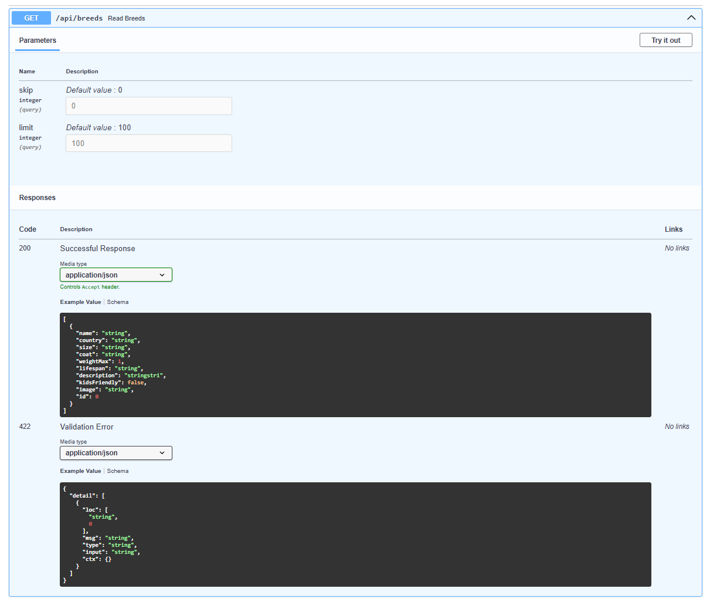
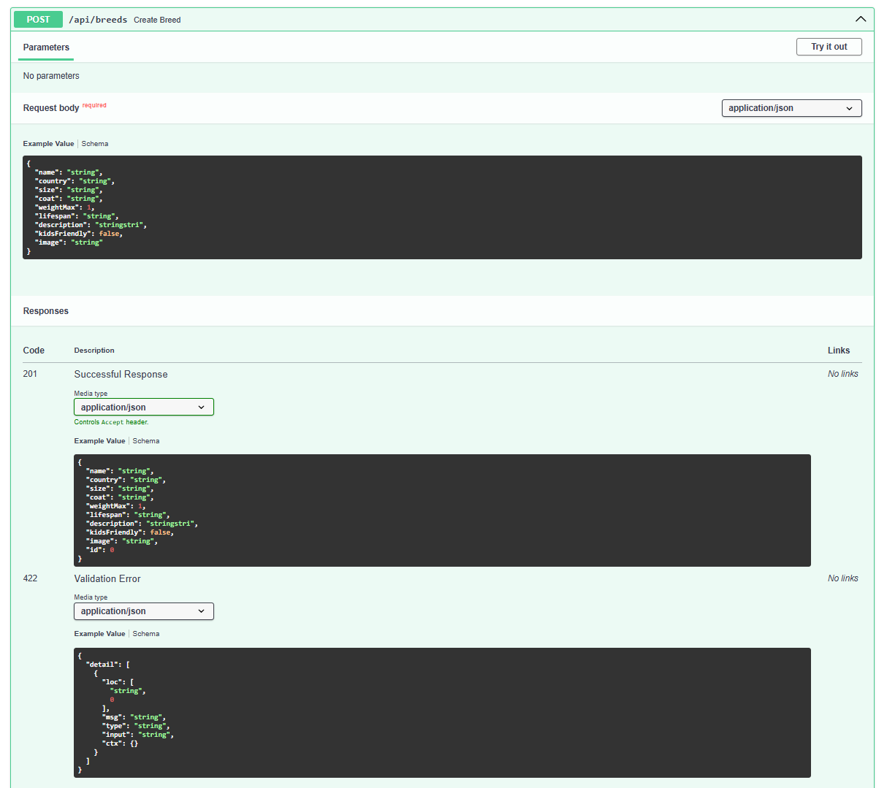
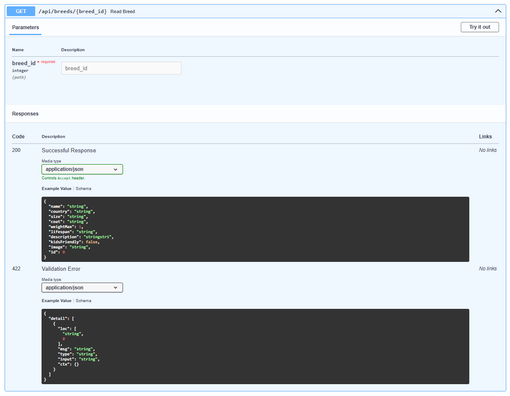
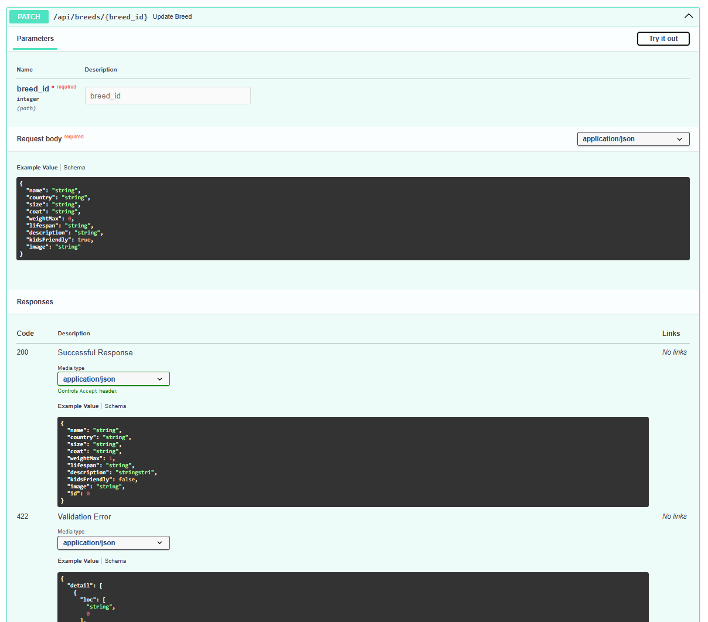
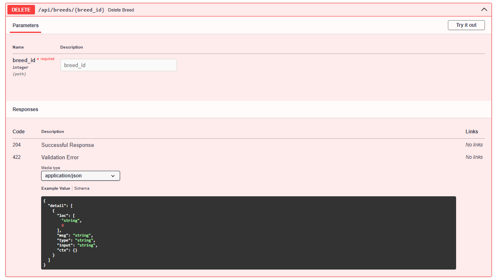
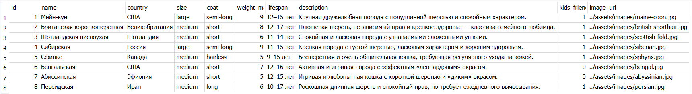
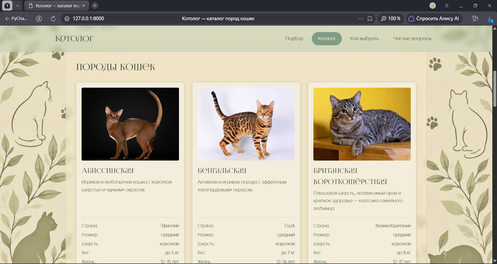

# Отчёт по лабораторной работе № 3

**Тема:** Backend с REST API и базой данных
**Проект:** «Котолог» — каталог пород кошек
**Выполнил(а):** Стебо Валерия, гр. ИВТ-ИСУ-302Б
**Дата:** 2026

---

## 1. Цель работы

Научиться разделять приложение на клиентскую и серверную части:
выделять сущности предметной области, проектировать REST API
для CRUD-операций, создавать backend на Python, хранить данные
в реляционной базе данных, автоматически генерировать
OpenAPI-спецификацию и получать данные на frontend через REST API.

---

## 2. Выбранная тема

**«Котолог» — каталог пород кошек** (категория «Каталоги и справочники»).

**Основная сущность:** Порода кошки (`CatBreed`).

Поля сущности:
- `id` — уникальный идентификатор (первичный ключ);
- `name` — название породы;
- `country` — страна происхождения;
- `size` — размер (малый, средний, крупный);
- `coat` — тип шерсти;
- `weight_max` — максимальный вес;
- `lifespan` — продолжительность жизни;
- `description` — описание породы;
- `kids_friendly` — подходит ли для семей с детьми;
- `image_url` — путь к изображению.

---

## 3. Структура проекта

```text
cats/
├── backend/
│   ├── main.py            # Точка входа FastAPI, настройка CORS и статики
│   ├── database.py        # Подключение к SQLite и сессия SQLAlchemy
│   ├── models.py          # Модель SQLAlchemy для таблицы breeds
│   ├── schemas.py         # Pydantic-схемы для валидации данных
│   ├── crud.py            # Функции работы с базой данных
│   ├── requirements.txt   # Зависимости Python
│   └── kotolog.db         # Файл базы данных SQLite (создается автоматически)
├── frontend/
│   ├── index.html
│   ├── css/
│   │   └── style.css
│   └── js/
│       └── app.js         # Логика работы с REST API (fetch)
├── assets/
│   ├── fonts/
│   └── images/
├── README.md
└── REPORT-3.md
```
---

## 4. Что сделано

### 4.1. База данных и сущности

- Выбрана реляционная база данных **SQLite** (в рамках локальной разработки).
- Создана таблица `breeds` с помощью ORM **SQLAlchemy** (файл `models.py`).
- Определён первичный ключ `id`, для обязательных полей задано ограничение `NOT NULL`.
- Для поднятия базы и её наполнения написан скрипт `seed.py`, который добавляет 8 демонстрационных пород при первом запуске.

### 4.2. Backend и REST API (FastAPI)

Backend реализован на Python с использованием фреймворка **FastAPI** (файл `main.py`). 
Реализованы все обязательные CRUD-операции:

- `GET /api/breeds` — получение списка всех пород (статус 200);
- `POST /api/breeds` — создание новой породы с валидацией данных (статус 201);
- `GET /api/breeds/{id}` — получение одной породы по идентификатору (статус 200 или 404);
- `PATCH /api/breeds/{id}` — частичное обновление данных породы (статус 200 или 404);
- `DELETE /api/breeds/{id}` — удаление породы из БД (статус 204 или 404).

Для валидации входящих данных (длины строк, допустимые числовые диапазоны) использованы **Pydantic-схемы** (файл `schemas.py`). При ошибке валидации сервер автоматически возвращает статус `422 Unprocessable Content`.

### 4.3. OpenAPI и Swagger UI

FastAPI автоматически генерирует OpenAPI-спецификацию. Интерактивная документация доступна по адресу `/docs`. В ней описаны все эндпоинты, схемы данных, возможные коды ответов и ошибки. Запросы можно выполнять прямо из интерфейса Swagger UI.

### 4.4. Frontend

Логика `frontend/js/app.js` была полностью переписана для работы с реальным сервером:

- **Загрузка данных:** при открытии страницы выполняется `fetch('/api/breeds')` (функция `loadBreeds`), полученные данные сохраняются в `state.items` и отрисовываются в карточках.
- **Создание записи:** форма отправляет `POST`-запрос с данными в формате JSON.
- **Обновление записи:** добавлена кнопка «Изменить», которая запрашивает новое название породы и отправляет `PATCH`-запрос.
- **Удаление записи:** кнопка «Удалить» отправляет `DELETE`-запрос.
- **Раздача статики:** для устранения проблем с CORS и путями к файлам, папки `frontend` и `assets` подключены к FastAPI через `StaticFiles`. Сайт открывается по тому же адресу, что и API (`http://127.0.0.1:8000/`).

---

## 5. Проверка работы

- Бэкенд успешно запускается командой `uvicorn main:app --reload`.
- Swagger UI доступен по адресу `http://127.0.0.1:8000/docs` и корректно отображает все методы API.
- При открытии корня сайта (`http://127.0.0.1:8000/`) данные загружаются с сервера и отображаются в карточках.
- При добавлении новой породы через модальное окно форма отправляет `POST`-запрос, и карточка сразу появляется в интерфейсе.
- При нажатии на «Изменить» название породы обновляется в базе данных через `PATCH`.
- При удалении запись исчезает из интерфейса и стирается из базы.
- После перезагрузки страницы данные не пропадают, так как они хранятся в БД.
- Проверка базы данных через программу *DB Browser for SQLite* подтверждает, что записи сохраняются в таблице `breeds`.

---

## 6. Скриншоты

### 6.1 Swagger UI с раскрытыми методами API
Ниже представлены все 5 реализованных методов REST API (полный набор CRUD) для сущности «Порода кошки».

**1. Получение списка всех пород (GET /api/breeds)**
Метод возвращает массив всех записей. Код ответа — 200 OK.



**2. Создание новой породы (POST /api/breeds)**
Метод принимает JSON с данными новой породы. Валидация Pydantic проверяет обязательные поля. Код ответа при успехе — 201 Created.



**3. Получение одной породы по ID (GET /api/breeds/{breed_id})**
Метод ищет запись по первичному ключу. Если запись найдена, возвращается 200 OK, если нет — 404 Not Found.



**4. Частичное обновление породы (PATCH /api/breeds/{breed_id})**
Метод позволяет обновить только те поля, которые переданы в теле запроса (например, только название). Код ответа — 200 OK.



**5. Удаление породы (DELETE /api/breeds/{breed_id})**
Метод полностью удаляет запись из базы данных. При успешном удалении возвращает статус 204 No Content.



### 6.2. Таблица breeds в базе данных SQLite

На скриншоте представлена таблица `breeds` в программе SQLiteStudio. В ней хранятся все добавленные записи о породах кошек.



### 6.3. Работающий фронтенд с загруженными данными

На скриншоте видно, что сайт открыт по адресу `http://127.0.0.1:8000/` (через FastAPI).



---

## 7. Вывод
В ходе лабораторной работы статический клиент-серверный проект «Котолог»
был разделён на независимые части. Освоены: проектирование REST API,
создание backend-приложения на Python (FastAPI), работа с реляционной базой данных
через ORM SQLAlchemy, валидация входящих данных с помощью Pydantic, а также интеграция
frontend с сервером с использованием асинхронных запросов (fetch, async/await).